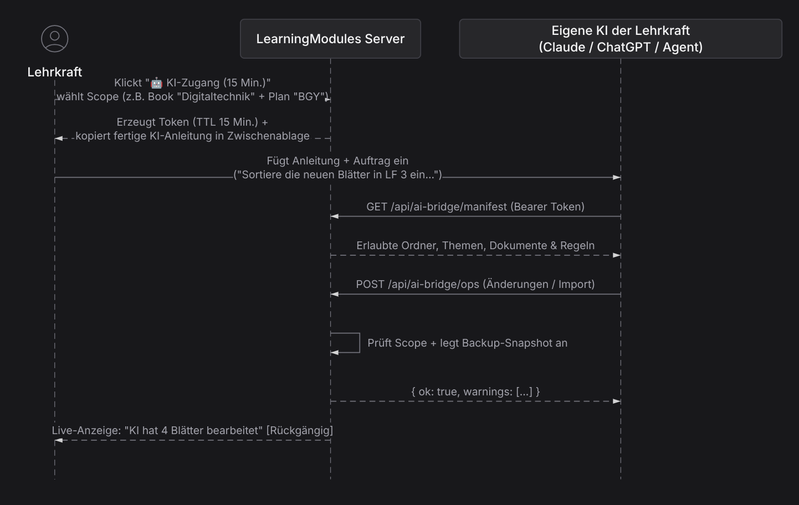

Verbesserungen:

1. UX & Umstiegshürde (Weg von OneNote hin zu Notizbuch → Planung → Klasse)
Warum der Umstieg für Lehrkräfte aktuell schwerfällt
Das Grundkonzept von LearningModules (Single Source of Truth: Fachinhalt einmal im Lernnotizbuch pflegen → in der Planung auf Bildungsgänge/Lernfelder abbilden → im Klassennotizbuch schrittweise freischalten) löst das größte Problem von OneNote (Copy-&-Paste-Chaos über 5 Parallelklassen hinweg, bei dem Korrekturen nie in allen Kopien ankommen).
Beim Blick in den Code (planning.js, notebooks.js, onenote-import.js) zeigen sich jedoch drei konkrete mentale und bedientechnische Hürden:
    1. Das „3-Ebenen-Vorab-Investment“ (Zu hoher Initialaufwand vor der ersten Unterrichtsstunde): 
        ◦ In OneNote denkt eine Lehrkraft: „Ich habe morgen die Klasse 11BG, ich lege einen Abschnitt an und ziehe mein Arbeitsblatt rein.“ 
        ◦ In LearningModules muss sie zuerst verstehen: 
            1. Wo liegt das Original? (Lernnotizbuch: Book → Bereich → Abschnitt → Lernthema → Modul) 
            2. Wie kommt es in den Bildungsgang? (Planung: Ordner → Plan → Bereich → Abschnitt → Verweis (Include)) 
            3. Wie sieht es die Klasse? (Klassenverwaltung: Klasse mit Plan verknüpfen → im Klassennotizbuch freischalten) 
    2. Double-Commander-Bedienparadigma in der Planung (PlanningView): 
        ◦ Die Zwei-Spalten-Ansicht mit Tab, F2, F3, F5 Verweis, F6 Verschieben, F7 Neu, F8 Entfernen und Leertaste Markieren ist für Entwickler und Power-User extrem schnell. 
        ◦ Für 90 % der Lehrkräfte (gewohnt an OneNote/Word/iPad) wirkt ein Norton-Commander-Interface jedoch fremd: Man sieht nur Ordnerpfade und Titel, keine visuelle Vorschau des Blatts, und die Unterscheidung, wann F5 kopiert vs. wann F5 einen Verweis (include) anlegt (planning.js), erfordert abstraktes Systemwissen. 
    3. OneNote-Import übernimmt aktuell keinen Seiteninhalt (openOneNoteImport): 
        ◦ Wie der Hinweistext in onenote-import.js ehrlich sagt: „Übernommen werden Seiten mit Anlagen … Text und Freihand bleiben in OneNote.“ Wer in OneNote direkt auf Seiten getippt oder Tafelbilder entwickelt hat, verliert diese beim .onepkg-Import komplett. 
Konkrete Verbesserungsvorschläge für UX & Onboarding
    • 1. „Schnellstart / Direkt- im-Klassenbuch-arbeiten“-Workflow (Planung im Hintergrund): 
        ◦ Erlaube Lehrkräften, direkt in ihrer Klasse ein Thema/Arbeitsblatt anzulegen oder hochzuladen. 
        ◦ Im Hintergrund legt die App das Material automatisch im Standard-Lernnotizbuch der Lehrkraft ab und erzeugt den Verweis (PlanNode / include) automatisch. Erst wenn die Lehrkraft dasselbe Material im nächsten Schuljahr in einer zweiten Klasse nutzen will, entdeckt sie den Mehrwert der Wiederverwendung – ohne vorab die 3-Schichten-Architektur lernen zu müssen. 
    • 2. Visuelle Vorschau (Quick-Look / Split-Drawer) in PlanningView: 
        ◦ Wenn der Cursor in der Planung auf einem Lernthema oder Dokument steht, sollte (optional per Leertaste oder in einer kleinen dritten Spalte / Popover) sofort eine Mini-Vorschau der enthaltenen Arbeitsblätter/Quizfragen erscheinen. Aktuell navigiert man „blind“ nur über Dateinamen. 
    • 3. Visuelle „Wo wird dieses Blatt verwendet?“-Anzeige (Reverse-Link-Badges): 
        ◦ Zeige im Lernnotizbuch und direkt im DocSpecEditor oben rechts kleine anklickbare Badges: 📋 Verwendet in: BGY-J1, 2BFE1 | 🟢 Freigeschaltet in: E2FS1. Das macht das „Einmal speichern, mehrfach verlinken“-Prinzip sofort greifbar und gibt Sicherheit („Wenn ich hier editiere, aktualisiere ich genau diese 2 Klassen“). 
    • 4. OneNote-Seiteninhalt mitnehmen: 
        ◦ In readOneSection lassen sich neben eingebetteten Dateien/Printouts auch die Text-Runs aus dem .one-Binärformat extrahieren (oder per OneNote-PDF-Export + PDF-Import einlesen). Schon das Extrahieren des reinen Seitentextes in ein DocSpec-Textmodul würde viele „leere Abschnitte“ beim OneNote-Umstieg verhindern. 

2. Bewertung & Verbesserung der Import-Filter (.odt/.docx, .pdf, .xopp)
Du hast völlig recht: Dass bestehende Dokumente nicht 1:1 übernommen werden, ist im Schulalltag der größte Bremsklotz. Die Untersuchung des Codes zeigt sehr genau, warum die Filter mal gut und mal schlecht funktionieren:
A. .odt / .docx Import (odt.ts + docspec-html.js)
    • Ist-Zustand (Doppelte verlustbehaftete Konvertierung):
        1. .docx wird über LibreOffice nach .odt konvertiert. 
        2. odt.ts wandelt das content.xml des .odt zunächst in einen HTML-String um (gedacht für das alte HTML-Modul). 
        3. Wenn daraus ein editierbares Arbeitsblatt (DocSpec) werden soll, parst htmlToDocSpec diesen HTML-String im Browser per DOMParser zurück in DocSpec-Blöcke. 
    • Warum das oft bricht:
        ◦ Aufgabennummerierung als Fließtext: Fast alle bestehenden Lehrer-Arbeitsblätter in Word/Writer nutzen keine semantischen Boxen, sondern tippen manuell Aufgabe 1:, 1., 1) oder a) fett an den Absatzanfang oder nutzen Word-Listen. htmlToDocSpec erkennt task / subtask / solution aber fast nur, wenn bereits spezielle CSS-Klassen (div.ds-widget) vorhanden sind. Dadurch landet ein ganzes Word-Arbeitsblatt oft als flache Wüste aus einfachen text- und list-Blöcken ohne echte task-/subtask-Struktur und ohne Punkte. 
        ◦ Bild neben Text / Textrahmen: In Word/Writer verankern Lehrer Bilder fast immer „Am Absatz“ mit Textumlauf rechts/links oder über eine unsichtbare 2-Spalten-Layouttabelle. Auf dem Weg .odt → HTML → htmlToDocSpec gehen Anker-Positionen verloren; das Bild rutscht als voller Block unter oder über den Absatz, oder eine 2-Spalten-Layouttabelle wird als echte Datentabelle mit Rahmen importiert statt als columns-Block (side-by-side). 
        ◦ Tabulatoren & Lückentexte: Lehrer bauen Lückentexte und Zuordnungen oft mit ____ oder Tab-Stopps (Name: _______ Datum: _______). HTML kollabiert Whitespaces/Tabs. 
    • Was am .odt/.docx-Filter konkret verbessert werden sollte:
        1. Direkter ODT-XML → DocSpec-Parser statt Umweg über HTML: Oder zumindest semantische Attribute (data-odt-style, data-frame-anchor, data-border-none) in odt.ts durchreichen. 
        2. Automatische Struktur-Erkennung in htmlToDocSpec: 
            ▪ Absätze, die mit ^(?:Aufgabe|Übung)\s*(\d+)[:.]?\s*(.*) (oder fettgedrucktem 1. ... + optional (4 P.) am Zeilenende) beginnen, automatisch in echte task-Blöcke (inkl. points) umwandeln! 
            ▪ Aufzählungen mit a), b), c) unterhalb eines task automatisch als subtask erkennen. 
            ▪ Rahmenlose 2-Spalten-Tabellen (links Text, rechts Bild) automatisch in das DocSpec-Element columns übersetzen. 
            ▪ Unterstrich-Ketten (_____ oder ……) automatisch als Schreiblinie (karo / Linie) oder Lücke erkennen. 
B. PDF-Import (pdf_import.py & pdf-ai.client.ts)
    • Ist-Zustand:
        ◦ pdf_import.py nutzt pdfplumber mit geometrischen Heuristiken: 
            ▪ Die 3 größten Schriftgrößen über dem Median werden zu Überschriften (big, Zeile 96–98). 
            ▪ Rote Schrift (_is_red, Zeile 153–159) wird zur Lösung (solution). 
            ▪ Kurze kursive Zeilen mit =+-/ werden per Regex-Heuristik als Formel geraten (_formulas, Zeile 202–233). 
            ▪ In Zeile 36–40 mussten IMPORT_FRAMES = False und SLIDE_HEADINGS = False bereits hart abgeschaltet werden, weil Vektor-Rahmen und Folien-Layouts sonst Text verschlucken oder falsch gruppieren. 
    • Warum das schwankt:
        ◦ PDF ist kein Strukturformat, sondern ein reines Koordinaten-Format („zeichne Buchstabe X an Position x,y“). Sobald ein Arbeitsblatt Kästchen, Schaltpläne mit Beschriftungen, Brüche auf zwei Zeilen oder zweispaltige Aufgaben hat, scheitert jede reine x/y-Koordinaten-Heuristik in _group_lines. 
    • Was am PDF-Import konkret verbessert werden sollte:
        1. Hybrid-Modus („Smart-Crop bei Unsicherheit“) in pdf_import.py: 
            ▪ Wenn eine Region auf der PDF-Seite viele kurze, verstreute Textfragmente neben Vektorlinien enthält (typisch für Schaltpläne, Kräftepfeile, Koordinatensysteme, Funktionsgraphen, Tabellen ohne Gitterlinien), darf pdf_import.py diese Textfetzen nicht als kaputte text-/formula-Absätze extrahieren. Stattdessen sollte die gesamte Bounding-Box automatisch als hochaufgelöstes Bild (PNG/SVG-Ausschnitt) gerendert und als image-Block eingebettet werden – während der normale Fließtext darüber und darunter editierbarer DocSpec-Text wird. 
        2. Interaktiver „Regionen-Wähler“ vor dem Import (Ausbau von pickPdfBlocks): 
            ▪ Zeige beim PDF-Import links die gerenderte PDF-Seite mit farbigen Rahmen um die erkannten Blöcke (Aufgabe, Text, Bild, Tabelle, Lösung). Mit einem Klick kann der Lehrer vor dem Übernehmen sagen: „Diesen Bereich nicht zerlegen, sondern als Bild ausschneiden“ oder „Das ist eine Aufgabe (task)“. Das dauert 10 Sekunden pro Blatt und macht aus einem 70-%-Import einen 100-%-Treffer. 
        3. Multimodaler Vision-LLM-Pass als Nachbesserer: 
            ▪ Wenn der lokale pdf-ai-Container (Surya/Marker) oder pdfplumber die Rohtexte und ausgeschnittenen Bilder geliefert hat, kann ein einziger multimodaler LLM-Aufruf (Seitenbild als PNG + extrahierter Rohtext → valides DocSpec-YAML) die semantische Zuordnung (task, subtask, points, solution, formula, table) nahezu fehlerfrei übernehmen. 

3. Bewertung von Renderer (worksheet-renderer) & Editor (lm-editor)
Stärken der aktuellen Architektur
    • Das DocSpec-Datenmodell (docspec.js & make_worksheet.py) ist didaktisch hervorragend durchdacht: Automatische Nummerierung über das gesamte Notizbuch hinweg (numbering.ts), gleichzeitige Erzeugung von Schülerblatt + Lösungsblatt aus einer Quelle, Karo-/Linienfelder (karo) die sich in der Schülerfassung automatisch aus der Länge der Musterlösung berechnen, und Skript-/Kompendium-Druck über ganze Ordner (worksheets.controller.ts). 
    • Der Dreiklang im DocSpecEditor (Visuell / Markdown / YAML links + A4-Vorschau rechts) bedient sowohl Einsteiger als auch KI-/Power-User. 
Schwachstellen & Verbesserungspotenzial beim Renderer
    1. Doppelte Rendering-Logik (Browser-HTML vs. Python-ODF): 
        ◦ Jedes Feature in docspec.js (Browser-Vorschau) muss synchron in make_worksheet.py (odfpy + LibreOffice) nachgebaut werden. 
        ◦ Problem Seitenumbruch-Drift: Die Funktion markPageBreaks im Browser schätzt Seitenumbrüche anhand von CSS-Pixelhöhen. LibreOffice Writer bricht Zeilen und Formeln beim PDF-Druck aber oft um 2–4 Zeilen anders um. Dadurch denkt der Lehrer in der Live-Vorschau „Passt genau auf 2 Seiten“, und das gedruckte PDF hat plötzlich eine 3. Seite mit 2 Zeilen Überhang. 
        ◦ Empfehlung: 
            ▪ Im Editor-Header neben Vorschau: Arbeitsblatt | Lösung einen kleinen Toggle „🖨️ Echte Druckvorschau (PDF)“ (oder einen „Seitenumbruch prüfen“-Button) anbieten, der das vom Renderer erzeugte PDF direkt im rechten Pane (oder als Overlay mit Seiten-Thumbnails) anzeigt. 
            ▪ Einen neuen Block/Attribut pageBreak: true (Seitenumbruch erzwingen) bzw. keepTogether: true (Aufgabe nicht über Seitenumbruch zerreißen) prominent als 1-Klick-Button in der visuellen Toolbar exponieren. 
    2. Performance von make_worksheet.py (LibreOffice-Kaltstarts): 
        ◦ Für jedes PDF-Rendering und jede Formel (StarMath) wird LibreOffice im Container aufgerufen. Wenn ein ganzes Kompendium (script/:nodeId/pdf) gerendert wird, summiert sich das. Ein dauerhaft laufender LibreOffice-Listener (--accept="socket,host=127.0.0.1,port=2002;urp;" via unoserver) im worksheet-renderer-Container senkt die Renderzeit für ein PDF von ~1,5–3 Sekunden auf ~150–300 ms – damit wäre sogar eine echte PDF-Live-Vorschau im Editor fast verzögerungsfrei möglich! 
    3. Visueller Editor (lm-editor): 
        ◦ Im visuellen Modus (pm-editor.js) wäre ein /-Slash-Menü (bekannt aus Notion/Confluence: Tippen von /aufgabe, /karo, /lösung, /formel, /spalten, /kasten) ein riesiger Gewinn für den Schreibfluss, damit man beim Tippen nicht ständig mit der Maus zur oberen Symbolleiste greifen muss. 

4. Bewertung deiner Idee: Zeitbeschränkte KI-Schnittstelle (z. B. 15-Minuten-Token)
Gesamtbewertung: Exzellente Idee – genau der richtige Hebel!
Aktuell läuft die KI-Integration in LearningModules über Copy & Paste (doc-prompt-view.js und ai-answer.js):
    1. Prompt generieren & in Zwischenablage kopieren 
    2. In ChatGPT / Claude / Gemini wechseln, einfügen, Anhänge hochladen 
    3. Antwort-Codeblock kopieren, zurück in LearningModules einfügen, auf Syntaxfehler prüfen (import-fix), ggf. Korrektur-Prompt zurückkopieren. 
   

Das hat den großen Vorteil, dass der Server keine eigenen OpenAI/Anthropic-API-Kosten trägt und Lehrer ihre eigenen KI-Accounts nutzen können. Aber bei größeren Aufgaben („Sortiere mir 30 importierte PDF-Blätter in die richtigen Lernfelder ein“, „Repariere die Formatierung von 10 importierten Word-Blättern“, „Ordne mein Lernnotizbuch dem neuen Lehrplan zu“) ist Copy & Paste viel zu kleinteilig.
Ein zeitlich und räumlich beschränktes KI-Zugriffs-Token (z. B. 15 Minuten TTL) kombiniert beide Welten perfekt: Null API-Kosten für deinen Server, aber die externe KI (Claude Desktop/Code, ChatGPT Custom GPT / Actions, lokaler Agent) kann direkt lesen, strukturieren und überarbeiten.
Wie ich das Token-Konzept technisch und sicher umsetzen würde
1. Eng gefasste Berechtigungen (Scope + Time-to-Live)
In der UI (z. B. oben in der Planung oder im Notizbuch über einen Button „🔑 KI-Zugriff (15 Min.)“) öffnet sich ein kleiner Dialog:
    • Gültigkeitsdauer: 15 Minuten (verlängerbar / jederzeit per 1-Klick widerrufbar) 
    • Geltungsbereich (Scope-Auswahl): 
        ◦ Worauf darf die KI zugreifen? (z. B. „Nur aktuelles Book: Digitaltechnik“ oder „Book Digitaltechnik + Plan BGY-J1“ – niemals automatisch auf Schülerdaten, Noten oder andere Klassen!) 
        ◦ Was darf die KI tun? 
            ▪ Nur Lesen (Struktur & Dokumente analysieren) 
            ▪ Strukturieren & Verknüpfen (Ordner, Themen, Plan-Verweise anlegen/umsortieren) 
            ▪ Inhalte anlegen & bearbeiten (Arbeitsblätter/Quizze importieren oder DocSpec überarbeiten) 
1. Zwei Nutzungswege mit demselben Token anbieten
Damit es sowohl mit Agenten-Tools (wie Claude Desktop / Claude Code / Cursor) als auch mit normalem Web-Chat (ChatGPT Plus, Claude Web) funktioniert:
    1. MCP-Server / CLI-Einzeiler (Königsweg für Claude Desktop / Claude Code): 
        ◦ Der Dialog zeigt einen kopierbaren Einzeiler oder eine MCP-URL: https://dein-server.de/api/ai-bridge/mcp?token=lm_tmp_... 
        ◦ Über 6–8 schlanke Tools kann die KI direkt arbeiten: 
            ▪ list_tree(scope) → Liefert den Baum (Books, Bereiche, Abschnitte, Lernthemen, Pläne) kompakt als Markdown/JSON 
            ▪ read_document(moduleId) → Liefert das Arbeitsblatt im kompakten lm-markdown-Format (aus pm-markdown.js) 
            ▪ write_document(moduleId, markdown, summary) → Validiert das DocSpec sofort serverseitig; wenn die KI einen Syntaxfehler macht, bekommt sie die Fehlermeldung direkt als Tool-Response zurück und korrigiert sich selbstständig ohne Lehrer-Interaktion! 
            ▪ move_or_link_topic(topicId, targetNodeId, mode: 'move' | 'include') → Sortiert Themen ein oder verknüpft sie in der Planung. 
    2. „Start-Prompt mit API-Ticket“: 
        ◦ Ein Klick auf „Prompt mit Token kopieren“ kopiert einen kurzen System-Prompt inklusive Token und Endpunkt-Beschreibung, den man einem Agenten gibt: „Hier ist mein 15-Minuten-Token für LearningModules. Bitte lies den Ordner ‚Import‘ aus, wandle die rohen Texte in saubere Arbeitsblätter mit Aufgaben/Lösungen um und ordne sie passend in den Plan ‚LF 4‘ ein.“ 
1. Das wichtigste Sicherheitsnetz: Transaktions-Log & 1-Klick-Rollback („KI-Änderungen prüfen“)
Lehrkräfte haben oft Angst, dass eine KI ihnen in 15 Minuten bestehende Struktur zerschießt.
    • Lösung: Jede Schreiboperation, die über ein solches 15-Minuten-Token hereinkommt, wird mit der aiSessionId des Tokens getaggt: 
        ◦ Bei Dokument-Änderungen legt LearningModules vorher automatisch einen DocumentVersion-Snapshot an (die Tabelle DocumentVersion hast du ohnehin schon in der Datenbank!). 
        ◦ Bei Struktur-Änderungen (Verschieben, Umbenennen, neue PlanNode-Verweise) wird ein kleines Audit-Log für diese 15-Minuten-Session mitgeschrieben. 
        ◦ Während das Token aktiv ist, sieht der Lehrer in der App ein kleines Live-Banner: 
          🤖 KI-Sitzung aktiv (noch 11:20 Min.) – 4 Dokumente überarbeitet, 6 Themen in „LF 3“ einsortiert. [Änderungen ansehen] [Rückgängig machen] [Zugriff beenden]

Zusammenfassung: Meine Top-Prioritäten-Empfehlung (Roadmap)
Wenn du mit möglichst wenig Aufwand den größten Effekt für Akzeptanz und Benutzerfreundlichkeit erzielen willst, würde ich in dieser Reihenfolge vorgehen:
    1. Quick-Win Import (.odt/.docx & .pdf): 
        ◦ In htmlToDocSpec eine Mustererkennung für Aufgabe 1 / 1. / a) und rahmenlose 2-Spalten-Tabellen ergänzen, damit importierte Word-/Writer-Blätter sofort echte task-, subtask- und columns-Blöcke werden. 
        ◦ Beim PDF-Import den bestehenden Dialog pickPdfBlocks um eine visuelle Seiten-Vorschau erweitern, in der man verunglückte Grafik-/Formelbereiche mit 1 Klick als Bildausschnitt (image) markieren kann. 
    2. Quick-Win UX (Planung & Editor): 
        ◦ Vorschau-Popover / 3. Spalte in PlanningView, damit man beim Zuordnen den Inhalt der Blätter sieht. 
        ◦ „Verwendet in …“-Badges am Arbeitsblatt + Direkt-Anlegen aus dem Klassennotizbuch (mit automatischer Ablage im Standard-Lernnotizbuch im Hintergrund). 
    3. Gamechanger KI-Workflow: 
        ◦ Den 15-Minuten-KI-Token (/api/ai-bridge) mit Scope-Begrenzung (nur ausgewählte Books/Pläne, niemals Schülerdaten) und automatischem DocumentVersion-Backup vor jedem KI-Schreibzugriff einbauen. 
Sollen wir einen dieser vier Punkte (z. B. das konkrete API-Design für den 15-Minuten-KI-Token oder die Verbesserungen am Import-Filter) direkt im Detail planen oder prototypisch umsetzen?
